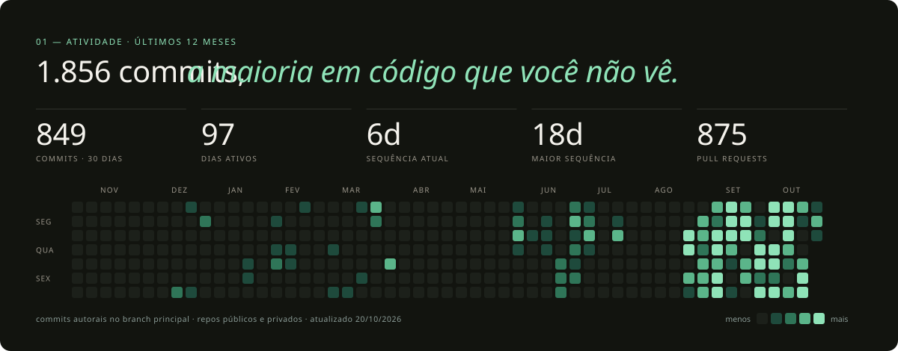
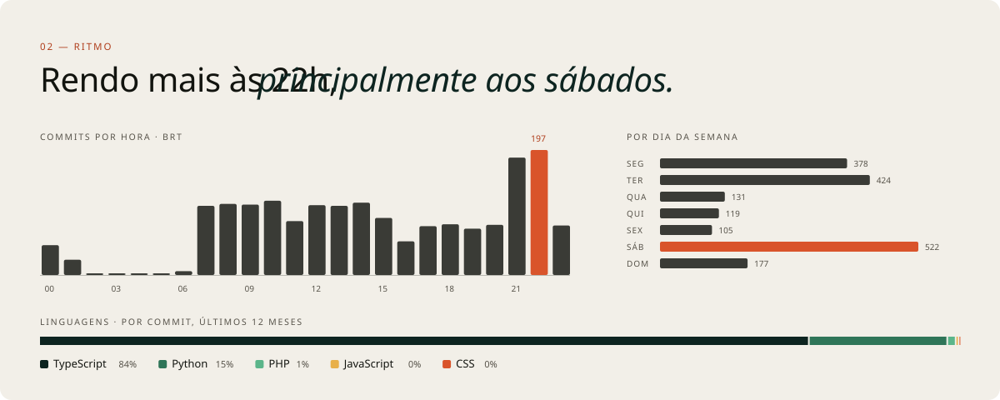
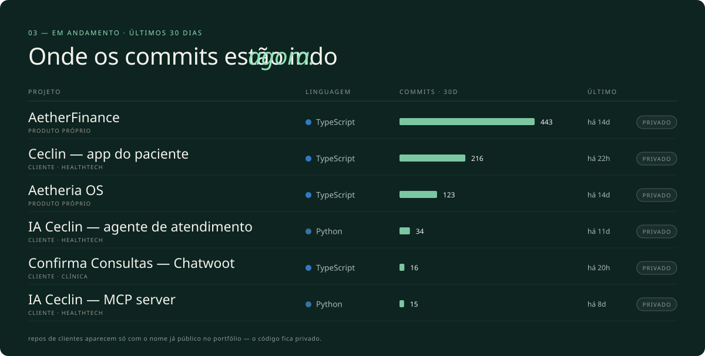
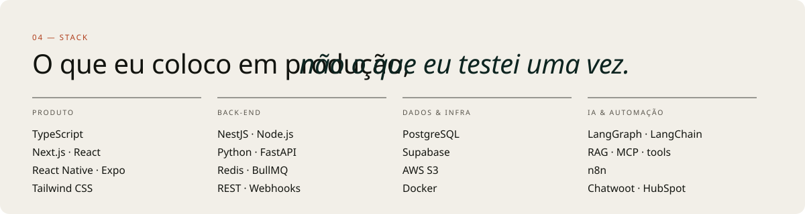

  <a href="https://arthurrangelh.com.br/"><code>arthurrangelh.com.br</code></a> &nbsp;·&nbsp;
  <a href="https://www.linkedin.com/in/arthur-rangelr/"><code>linkedin</code></a> &nbsp;·&nbsp;
  <a href="https://x.com/Artreasure_"><code>x.com/Artreasure_</code></a> &nbsp;·&nbsp;
  <a href="mailto:contato@arthurrangelh.com.br"><code>contato@arthurrangelh.com.br</code></a>

painéis gerados a partir da API do GitHub · <a href="./scripts">scripts/</a>

